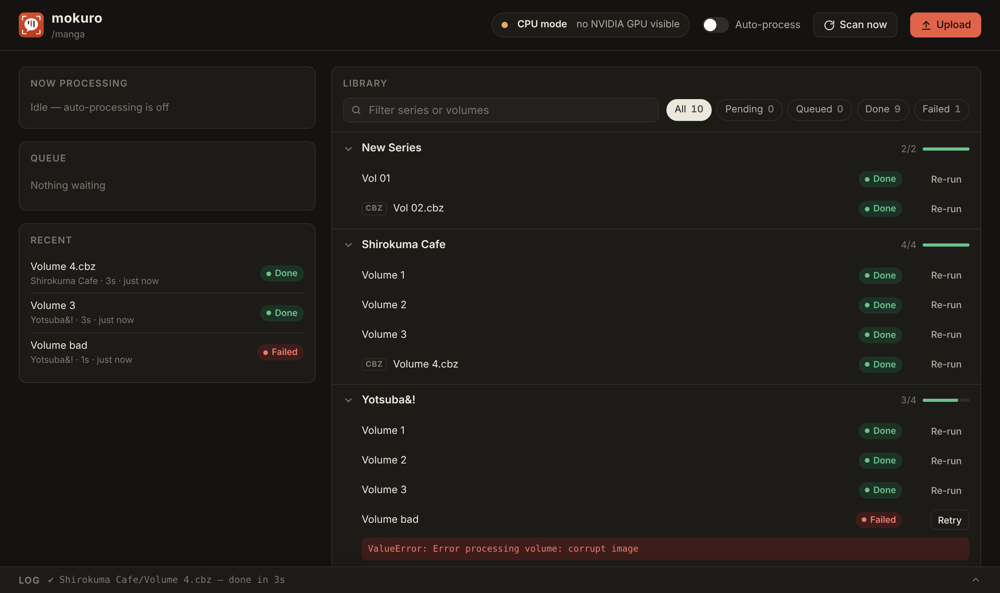

# mokuro-unraid

A Docker image for [mokuro](https://github.com/kha-white/mokuro) 0.2.5 with CUDA and a web UI. It writes a `.mokuro` file next to every volume in your manga share, which you then open in [reader.mokuro.app](https://reader.mokuro.app/) (or a self-hosted mokuro-reader).

## Web UI



Open `http://<unraid-ip>:8090` (or click **WebUI** on the container icon).

- **Library**: every series and volume with its status (Pending, Copying, Queued, Processing, Done, Failed), with search and status filters. Process, retry, re-run or cancel a single volume, or a whole series.
- **Now processing**: live page progress, speed and time left, with a Cancel button.
- **Queue / Recent**: what's waiting and what just finished, with how long each took.
- **Auto-process switch**: when on, new volumes are queued automatically every scan. **Scan now** checks immediately.
- **Upload**: drag in `.cbz`/`.zip` files or folders of images, choose (or type a new) series name, and they're saved to the share and queued.
- **GPU chip**: card name, utilisation, VRAM and temperature, or a warning if it's running on the CPU.
- **Log**: click the bar at the bottom for mokuro's output.

Failed volumes show the error inline and aren't retried automatically, so one bad volume doesn't loop forever.

## Install on Unraid

1. Install the **Nvidia Driver** plugin (Apps → search "Nvidia Driver") and reboot. `nvidia-smi` in the Unraid terminal should list your card.
2. In the Unraid terminal, download the template:

   ```bash
   wget -O /boot/config/plugins/dockerMan/templates-user/my-mokuro.xml \
     https://raw.githubusercontent.com/croissantpigbear/mokuro-unraid/main/my-mokuro.xml
   ```

3. Docker tab → **Add Container** → Template: **mokuro** → set your manga path → **Apply**.

Unraid pulls `ghcr.io/croissantpigbear/mokuro-unraid:latest` (~6 GB, mostly PyTorch + CUDA). When a new version is published, the Docker tab shows **update ready** like any other container.

### docker compose instead

With the Compose Manager plugin: edit the paths in `docker-compose.yml`, then `docker compose up -d`.

## Updating the image

Every push to `main` builds and publishes a new `latest` image via GitHub Actions (about 10–15 minutes). Tag a release (`git tag v1.0.0 && git push --tags`) to also publish `1.0.0`, which you can pin in the template's Repository field. To build locally instead: `docker build -t mokuro-unraid .`

## Folder layout

```
manga/
├─ Series A/
│  ├─ vol1/          ← folder of images  → Series A/vol1.mokuro
│  └─ vol2.cbz       ← archive           → Series A/vol2.mokuro (+ extracted vol2/)
└─ Series B/ ...
```

Volumes that already have a `.mokuro` file count as done, so restarts are safe. Volumes modified in the last `SETTLE_SECONDS` show as "Copying" and wait until copying finishes.

## Settings

| Variable | Default | Meaning |
|---|---|---|
| `WEBUI_PORT` | `8090` | Port the UI listens on inside the container |
| `WEBUI_PASSWORD` | *(empty)* | If set, the browser asks for a login: any username + this password |
| `WATCH` | `true` | Initial state of the Auto-process switch (the UI remembers changes) |
| `SCAN_INTERVAL` | `300` | Seconds between automatic scans |
| `SETTLE_SECONDS` | `120` | Wait this long after the last change before processing |
| `EXTRA_ARGS` | `--disable_html=True` | Passed to mokuro. Remove to also get legacy HTML output |
| `FORCE_CPU` | `false` | Ignore the GPU |
| `PUID` / `PGID` / `UMASK` | `99` / `100` / `000` | Ownership of created files (Unraid nobody:users) |

`/config` holds the OCR models (~500 MB, downloaded on first run), the UI state (queue, history, failures) and temporary files from uploads, so large uploads don't fill your docker.img.

## Manual one-off run

```bash
docker run --rm --runtime=nvidia -e NVIDIA_VISIBLE_DEVICES=all \
  -v /mnt/user/data/manga:/manga -v /mnt/user/appdata/mokuro:/config \
  ghcr.io/croissantpigbear/mokuro-unraid /manga/"Series A"/vol1
```

Anything after the image name is passed straight to `mokuro` and the UI isn't started.

## Troubleshooting

- **GPU chip says "CPU mode"**: add `--runtime=nvidia` to Extra Parameters and set `NVIDIA_VISIBLE_DEVICES`.
- **"CUDA unavailable"**: the card is visible but PyTorch can't use it, usually because the driver is older than 550 (CUDA 12.4 needs it) or the card is older than Maxwell (GTX 900).
- **Permission errors writing to the share**: check `PUID`/`PGID` match the share owner (99/100 is standard on Unraid).
- **Exposing it outside your LAN**: set `WEBUI_PASSWORD` and put it behind a reverse proxy with HTTPS. There's no other access control.

## License

GPL-3.0, the same as [mokuro](https://github.com/kha-white/mokuro), which this image installs unmodified from PyPI. mokuro, manga-ocr and comic-text-detector are the work of their authors; this repo only adds the container, web UI and Unraid template.
